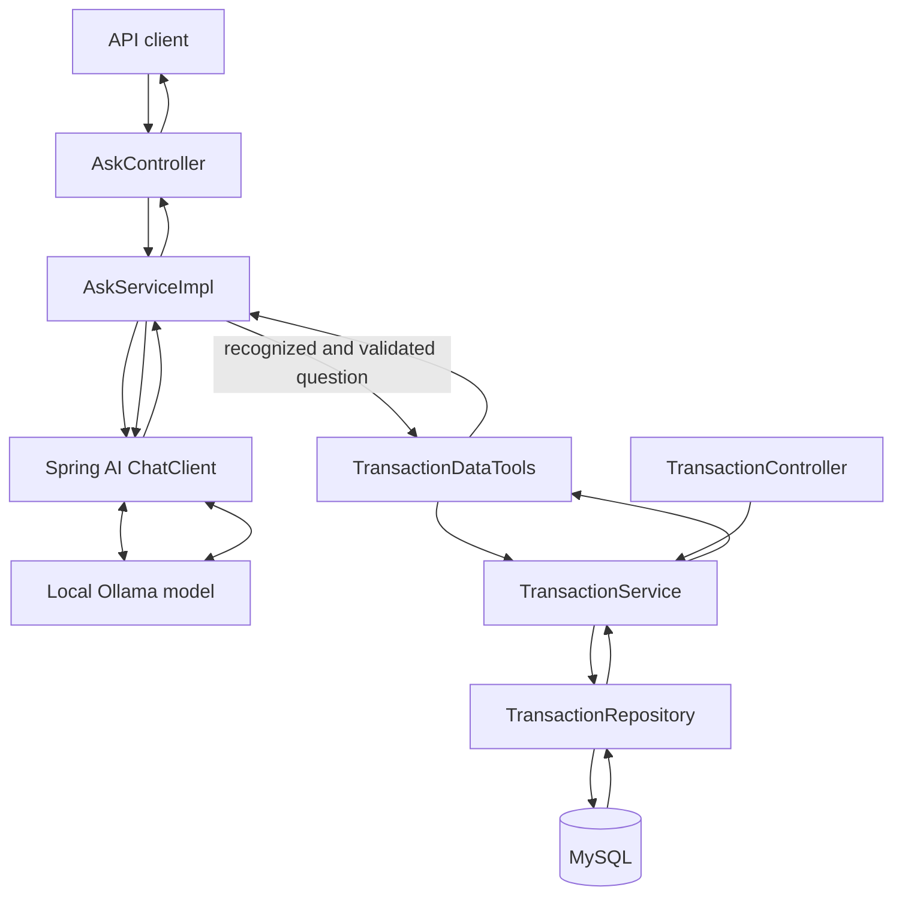

# FinAssist AI

FinAssist AI is a Spring Boot financial transaction analysis assistant. It provides transaction CRUD, filtering, backend-calculated summaries, and an Ollama-backed `/api/ask` endpoint that routes supported questions through bounded, validated backend queries. Use synthetic/demo records only.

## Current implementation status

### Implemented

- Create, list, retrieve, update, and delete transactions over REST.
- Persist transactions with Spring Data JPA and MySQL.
- Validate transaction input and report client errors in a consistent JSON format.
- Filter and paginate transaction lists.
- Use `BigDecimal` for money and string-backed enums for transaction type and status.
- Create/update the database schema without dropping existing data.
- Answer general financial questions through a local Ollama model using Spring AI.
- Route supported AI transaction questions through narrowly scoped, validated backend query operations.
- Return structured backend evidence alongside the AI answer, including bounded transaction results or exact summary statistics.
- Use a configurable reporting time zone (UTC by default) for "this month" transaction summaries.
- Responsive Angular dashboard, transaction CRUD/filtering, and AI assistant pages backed by the REST API.

### Not implemented

- Authentication, authorization, and per-user/tenant transaction isolation.
- Bank integrations, conversation memory, embeddings, vector search, or RAG.

**Security limitation:** the API currently has no Spring Security dependency or identity model. Transaction records are shared and the implemented endpoints are unauthenticated. Do not deploy this version with real or private financial information. Authentication and user/tenant scoping must be designed and enforced in backend queries before such use.

## Technology stack

- Java 21
- Spring Boot 4.1.1
- Spring MVC
- Spring AI 2.0.1 `ChatClient` with Ollama
- Spring Data JPA / Hibernate
- MySQL
- Jakarta Bean Validation
- JUnit 5, Mockito, and Spring Boot MVC test support
- Angular 19 standalone frontend, TypeScript, RxJS, Reactive Forms, and Jasmine/Karma

## Prerequisites

- JDK 21
- MySQL running locally
- Ollama running locally with the `codellama:latest` model available
- A shell in the repository root (the `FinAssist` directory contains the Maven project and wrapper)

## Local database and configuration

Create the development database once in MySQL:

```sql
CREATE DATABASE finassistdb;
```

The application defaults to `jdbc:mysql://localhost:3306/finassistdb` and username `root`. Configure the local password through environment variables; no database password is committed:

```powershell
$env:DB_USERNAME = "root"
$env:DB_PASSWORD = "your-local-password"
```

Optional overrides:

```powershell
$env:DB_URL = "jdbc:mysql://localhost:3306/finassistdb"
```

The JPA setting `spring.jpa.hibernate.ddl-auto=update` lets Hibernate create or update the `transactions` table without dropping existing tables or rows. The application must be able to connect to MySQL at startup. The table is not created if the database is unavailable.

## Ollama setup

Ollama must be installed and running separately from the Spring Boot application. Confirm the local server and installed model in PowerShell:

```powershell
ollama --version
ollama list
```

Ensure `codellama:latest` appears in the model list. Start the Ollama service if it is not already running:

```powershell
ollama serve
```

The application defaults to `http://localhost:11434` and `codellama:latest`. Override these values with `OLLAMA_BASE_URL`, `OLLAMA_MODEL`, and optionally `OLLAMA_TEMPERATURE` before starting Spring Boot:

```powershell
$env:OLLAMA_BASE_URL = "http://localhost:11434"
$env:OLLAMA_MODEL = "codellama:latest"
$env:OLLAMA_TEMPERATURE = "0.7"
```

The normal UI flow is Angular at `http://localhost:4200` → Spring REST API at `http://localhost:8080`. The Angular development server proxies `/api` requests to Spring Boot; no permissive backend CORS policy is added. The AI request path is Angular → `AskController` → `AskServiceImpl` → Spring AI `ChatClient` ↔ local Ollama. The configured `codellama:latest` model supports text completion but does not advertise Ollama tool-calling capability. Therefore, the backend deterministically routes supported transaction questions into the existing validated read-only transaction operations before calling the model. The model receives only the resulting minimized records or backend summary in its prompt; it cannot access repositories or execute SQL. Tool-style searches are capped at 20 records. The API returns exact backend-derived structured data alongside the generated explanation.

## Run the application

From the repository root in PowerShell:

```powershell
Set-Location .\FinAssist
.\mvnw.cmd spring-boot:run
```

The API listens at `http://localhost:8080`. You can confirm the table was created by connecting to `finassistdb` and running:

```sql
SHOW TABLES;
DESCRIBE transactions;
```

The `transactions` table stores transaction type and status as readable enum strings. Amounts use `DECIMAL(19,2)`. The `createdAt` timestamp is assigned when a transaction is first persisted and cannot be updated through the API.

## Run the Angular frontend

Prerequisites: Node.js `20.11.1` or newer in the Node 20 line (this workspace uses Node `20.14.0`) and npm. The frontend is in [`finassist-frontend/`](finassist-frontend/), uses Angular 19, and does not add backend dependencies.

Start the backend first as above. Then in a second PowerShell terminal:

```powershell
Set-Location .\finassist-frontend
npm install
npm start
```

Open `http://localhost:4200`. The Angular dev server sends `/api/**` to `http://localhost:8080` using [`proxy.conf.json`](finassist-frontend/proxy.conf.json), so local development does not require CORS changes. For a separately hosted production frontend, configure a narrow allowed origin in the backend/deployment environment; there is no CORS policy configured in this repository. API base URL is centralized in [`environment.ts`](finassist-frontend/src/environments/environment.ts) and defaults to the same-origin `/api` proxy path.

The UI includes:

- Dashboard cards and recent transactions from the backend summary and paginated list endpoints; totals are not calculated from the visible page.
- Transaction create/edit forms validated against the real API fields, confirmed deletion, pagination, and supported type/status/category/amount/date filters.
- An in-memory AI conversation that posts to the backend `/api/ask` endpoint, displays backend summary/search evidence, and does not persist chat history.
- Loading, empty, retry, and error states. Monetary values are displayed as decimal amounts without a currency symbol because the backend does not define a currency.

Run frontend production build and unit tests from `finassist-frontend`:

```powershell
npm run build
npm test -- --watch=false --browsers=ChromeHeadless
```

The frontend is unauthenticated, just like the current backend. All pages use the shared demo dataset; do not enter real private financial data.

## REST API

All request and response bodies use JSON. Send `Content-Type: application/json` for POST and PUT. Timestamps use ISO local date-time format, for example `2026-10-24T12:30:00`.

No authentication is currently configured: these routes are public and operate on the shared database. There is no 401/403 login flow or per-user transaction scope. This is an explicit local-demo limitation, not a security guarantee; do not use real financial data or expose the service to an untrusted network.

| Method | URL | Successful response |
| --- | --- | --- |
| POST | `/api/transactions` | `201 Created`, response body and `Location` header |
| GET | `/api/transactions` | `200 OK`, paginated response |
| GET | `/api/transactions/{id}` | `200 OK`, one transaction; `404 Not Found` if absent |
| PUT | `/api/transactions/{id}` | `200 OK`, updated transaction; `404 Not Found` if absent |
| DELETE | `/api/transactions/{id}` | `204 No Content`; `404 Not Found` if absent |
| POST | `/api/ask` | `200 OK`, generated answer; `400` for invalid question; `503` if AI service is unavailable |

### Create a transaction

`POST /api/transactions` — returns `201 Created`, a `Location` header, and the created transaction. Status defaults to `PENDING` when omitted.

```json
{
  "transactionType": "EXPENSE",
  "amount": 42.75,
  "category": "FOOD",
  "merchant": "Harbor Cafe",
  "description": "Lunch",
  "transactionDate": "2026-10-24T12:30:00"
}
```

Example response (`201 Created`):

```json
{
  "id": 12,
  "transactionType": "EXPENSE",
  "amount": 42.75,
  "category": "FOOD",
  "merchant": "Harbor Cafe",
  "description": "Lunch",
  "transactionDate": "2026-10-24T12:30:00",
  "status": "PENDING",
  "createdAt": "2026-10-24T12:31:00"
}
```

Valid transaction types are `INCOME` and `EXPENSE`; valid statuses are `PENDING`, `COMPLETED`, and `FAILED`. The amount must be positive with no more than two decimal places. Category and merchant are required.

### List and filter transactions

`GET /api/transactions` — returns a page of transactions, newest transaction date first. Defaults are `page=0` and `size=20`; page must be non-negative and size must be 1–100. The response contains `content`, `page`, `size`, `totalElements`, `totalPages`, and `last`.

Supported optional filters can be combined:

| Query parameter | Meaning |
| --- | --- |
| `minAmount`, `maxAmount` | Inclusive amount bounds |
| `status` | `PENDING`, `COMPLETED`, or `FAILED` |
| `transactionType` | `INCOME` or `EXPENSE` |
| `category` | Exact category match, such as `FOOD` |
| `startDate`, `endDate` | Inclusive ISO local date-time bounds |
| `page`, `size` | Pagination |

Examples:

```text
GET http://localhost:8080/api/transactions
GET http://localhost:8080/api/transactions?minAmount=100&maxAmount=5000
GET http://localhost:8080/api/transactions?status=COMPLETED
GET http://localhost:8080/api/transactions?transactionType=EXPENSE&category=FOOD
GET http://localhost:8080/api/transactions?startDate=2026-10-01T00:00:00&endDate=2026-10-25T23:59:59
GET http://localhost:8080/api/transactions?minAmount=100&maxAmount=5000&status=COMPLETED&transactionType=EXPENSE&category=FOOD
```

Example list response (`200 OK`):

```json
{
  "content": [],
  "page": 0,
  "size": 20,
  "totalElements": 0,
  "totalPages": 0,
  "last": true
}
```

When provided, `minAmount` must be greater than zero and cannot exceed `maxAmount`. `startDate` cannot be after `endDate`. Invalid enum values, date formats, and ranges return `400 Bad Request` with the invalid parameter identified in `details`.

### Transaction summary

`GET /api/transactions/summary` returns transaction statistics from the stored data. It accepts optional `startDate` and `endDate` parameters in the same ISO local date-time format used by transaction search. Dates are inclusive; either bound may be supplied alone. `startDate` after `endDate` returns `400 Bad Request`.

The response is a dedicated summary DTO:

```json
{
  "totalIncome": 3200.00,
  "totalExpenses": 245.50,
  "netBalance": 2954.50,
  "totalTransactions": 5,
  "completedTransactions": 2,
  "pendingTransactions": 2,
  "failedTransactions": 1,
  "expenseTotalsByCategory": [
    { "category": "FOOD", "totalAmount": 145.50 },
    { "category": "TRAVEL", "totalAmount": 100.00 }
  ],
  "incomeTotalsByCategory": [
    { "category": "SALARY", "totalAmount": 3200.00 }
  ]
}
```

Only `COMPLETED` transactions contribute to income, expenses, net balance, or category totals. Transaction counts include all transactions in the selected date range and separately report `COMPLETED`, `PENDING`, and `FAILED`. For example, the response above has 3,200.00 completed income minus 245.50 completed expenses, yielding a 2,954.50 net balance. Pending and failed transactions are counted but do not change those financial totals. Empty date ranges return zero totals and empty category arrays.

Example requests:

```text
GET http://localhost:8080/api/transactions/summary
GET http://localhost:8080/api/transactions/summary?startDate=2026-10-01T00:00:00&endDate=2026-10-27T23:59:59
GET http://localhost:8080/api/transactions/summary?startDate=2026-10-01T00:00:00
GET http://localhost:8080/api/transactions/summary?startDate=2026-10-28T00:00:00&endDate=2026-10-27T23:59:59
```

The last request returns `400 Bad Request`. Malformed date values are also rejected by the existing query-parameter error handling.

The repository uses database-side `SUM`, `COUNT`, and `GROUP BY` aggregates. The database processes matching rows and returns compact totals rather than loading every transaction into Java, which reduces application memory use and transfer volume as the table grows. The service safely converts SQL `NULL` aggregate values to zero, computes net balance with `BigDecimal`, and splits grouped results into expense and income category lists. It uses a straightforward loop for this small transformation; Java Streams are not used to regroup transaction rows because grouping is already done efficiently by the database.

The summary route is a separate literal mapping under `/api/transactions`; it does not replace the collection list or the numeric `/{id}` resource route.

### Ask a general financial question

`POST /api/ask` accepts a nonblank question and returns the original question with an answer generated by the configured local Ollama model. Send `Content-Type: application/json`.

```json
{
  "question": "Explain the difference between saving and investing."
}
```

Example response (`200 OK`; the generated wording may vary):

```json
{
  "question": "Explain the difference between saving and investing.",
  "answer": "Saving generally keeps money accessible for near-term needs, while investing puts money into assets for potential long-term growth and carries a risk of loss.",
  "data": null
}
```

Blank, whitespace-only, or missing questions return `400 Bad Request` with a field-specific `details.question` message. If Ollama cannot generate a nonblank answer, the API returns `503 Service Unavailable` with a generic error body. Invalid tool arguments return `400`; transaction data query failures return a sanitized `500`. Transaction questions can invoke the approved read-only transaction tools. The response includes `data.summary` or `data.search` when backend data was retrieved; it is `null` for general questions or unsupported transaction requests. Empty backend results get a deterministic empty-result answer rather than model-generated amounts.

Try these questions:

```json
{"question":"What is compound interest?"}
{"question":"How can I create a monthly budget?"}
{"question":"How much did I spend this month?"}
{"question":"Show completed transactions"}
{"question":"Find expenses with an amount of at least 5000"}
{"question":"Summarize transactions from 2026-10-01T00:00:00 to 2026-10-25T23:59:59"}
```

Transaction searches support the existing status, type, exact category, positive min/max amount, and inclusive date filters. Amount bounds are inclusive (`minAmount=5000` means at least 5,000); strict greater-than matching is not a distinct filter. Tool search results are capped at 20 records and contain only ID, type, amount, category, transaction date, and status. Summary totals and counts come from the backend summary service and are returned in `data.summary.statistics`; completed income/expenses contribute to totals, while pending and failed transactions are counted but excluded. A summary is not an account balance. The reporting zone defaults to UTC and can be changed with `FINASSIST_REPORTING_ZONE`; stored `LocalDateTime` values do not contain a zone, so that configuration defines which calendar month bounds are used.

Unsupported/ambiguous questions are not satisfied by guessing filters. Tool arguments are validated again in the backend. A model may still produce variable natural-language wording, so use the structured `data` fields as the authoritative values. No API connects to a bank or calculates a real account balance.

## Architecture and data flow



- **Controllers** validate HTTP input and map service results to response DTOs.
- **AskServiceImpl** owns AI orchestration and creates a per-request transaction-query helper so returned data and query state cannot leak across requests.
- **TransactionDataTools** contains only read-only operations; it validates enum, amount, date, and range inputs and caps search output at 20.
- **TransactionService** is the shared business layer for CRUD, specifications, pagination, and database-side summaries.
- **TransactionRepository/MySQL** execute parameterized Spring Data JPA queries and aggregates; the model has no direct database access.
- **GlobalExceptionHandler** maps validation, missing resources, model failures, and tool failures into the common error structure without returning internal exception details.
- **Ollama** runs locally at the configured base URL. Its natural-language response is not the authority for numeric facts; backend data returned in the API is.

### Design trade-offs and limitations

- Financial totals are calculated with backend `BigDecimal`/database aggregates to avoid asking the LLM to perform arithmetic.
- Deterministic database filters remain the source of truth for structured questions; recognized natural-language constraints are validated before service execution.
- The current Codellama build has no Ollama tool-calling capability. Instead of attaching unsupported function schemas and failing all prompts, the backend maps a limited set of recognizable questions (month summary, transaction count/status, amount threshold, and explicit date range) to validated service calls, and passes the returned data to Ollama. Unsupported personal financial questions return a limitation rather than guessed data.
- Tool search returns only a bounded, minimized set of fields. It is not a replacement for transaction APIs or an unrestricted data export.
- Local Ollama avoids sending prompts to a hosted model, but generation can be slow and constrained by local hardware/model quality. Ordinary tests mock AI calls.
- Vector search was deliberately not added: structured fields and totals require deterministic database logic, and semantic description retrieval is not essential for the current model. Avoiding extra dependencies/infrastructure keeps the core stable.
- No Spring Security, user identity, authorization, or transaction ownership scope exists. All current routes are unauthenticated and share one dataset. This is suitable only for local/demo data; adding security requires selecting an identity approach and then enforcing ownership in every backend query, not in an LLM prompt.
- The database is a shared development/demo database. Seed or create synthetic records only. Do not treat outputs as live bank data or as financial advice.

### Request/response example for transaction analysis

`POST /api/ask`

```json
{
  "question": "How much did I spend this month?"
}
```

Illustrative response shape (amounts/counts below are placeholders; actual values come from the database):

```json
{
  "question": "How much did I spend this month?",
  "answer": "The backend summary shows ...",
  "data": {
    "summary": {
      "startDate": "2026-10-01T00:00:00",
      "endDate": "2026-10-31T23:59:59.999999",
      "statistics": {
        "totalIncome": 0.00,
        "totalExpenses": 0.00,
        "netBalance": 0.00,
        "totalTransactions": 0,
        "completedTransactions": 0,
        "pendingTransactions": 0,
        "failedTransactions": 0,
        "expenseTotalsByCategory": [],
        "incomeTotalsByCategory": []
      }
    },
    "search": null
  }
}
```

Structured fields can be cross-checked against `GET /api/transactions/summary` with the same date bounds. Do not assert exact AI prose.

### Retrieve one transaction

`GET /api/transactions/{id}` — returns `200 OK` and the transaction, or `404 Not Found` if it does not exist.

### Update a transaction

`PUT /api/transactions/{id}` — replaces all editable transaction fields and returns `200 OK`. All fields except `description` are required, including `status`.

```json
{
  "transactionType": "EXPENSE",
  "amount": 48.25,
  "category": "FOOD",
  "merchant": "Harbor Cafe",
  "description": "Updated lunch total",
  "transactionDate": "2026-10-24T12:30:00",
  "status": "COMPLETED"
}
```

### Delete a transaction

`DELETE /api/transactions/{id}` — returns `204 No Content`, or `404 Not Found` if no transaction exists.

### Error response

Validation and filter errors return `400`; missing transaction IDs return `404`. Responses use this shape without exposing internal exception details:

```json
{
  "status": 400,
  "error": "Bad Request",
  "message": "Request validation failed",
  "details": {
    "amount": "must be greater than or equal to 0.01"
  }
}
```

Malformed query values identify the query parameter and explain the expected format or enum values. Unexpected server errors return `500` with a generic message; details are logged server-side and are not returned to the client.

Validation examples:

```text
POST http://localhost:8080/api/transactions
Content-Type: application/json

{"transactionType":"EXPENSE","amount":42.75,"category":"FOOD","merchant":"Harbor Cafe","transactionDate":"2026-10-24T12:30:00"}
```

Expected: `201 Created`.

```text
POST http://localhost:8080/api/transactions
Content-Type: application/json

{"transactionType":"EXPENSE","amount":0,"category":"FOOD","merchant":"Harbor Cafe","transactionDate":"2026-10-24T12:30:00"}
```

Expected: `400 Bad Request`, with an amount validation message under `details.amount`.

```text
GET http://localhost:8080/api/transactions?minAmount=0
GET http://localhost:8080/api/transactions?status=UNKNOWN
GET http://localhost:8080/api/transactions?startDate=not-a-date
```

Expected: `400 Bad Request`, with `details.minAmount`, `details.status`, or `details.startDate` identifying the invalid parameter.

## Postman

Import [`FinAssist/postman/FinAssist-AI.postman_collection.json`](FinAssist/postman/FinAssist-AI.postman_collection.json) into Postman and select the collection variables. Set `baseUrl` to `http://localhost:8080`. `transactionId` is automatically set by **Transaction CRUD → Create transaction**; no token or credential variable exists because authentication is not implemented.

The collection has these folders and checks:

- **Transaction CRUD:** create, retrieve, update, and delete. Run in that order; create stores the generated ID.
- **Transaction Search and Filters:** page shape, completed status, amount/status, type/category, and inclusive date range.
- **Transaction Summary:** all-record and date-range aggregates. The all-record request stores backend count/expense values for comparison.
- **AI Tool Calling:** general question, current-month summary, completed status, amount threshold, date-range summary, an intentionally high threshold with no matches, unsupported account-balance question, and a structured-value comparison. The AI checks assert response shape/data, not exact prose.
- **Validation and Error Handling:** blank/missing question, invalid status/range, missing transaction, and an optional Ollama outage test. Stop Ollama before running the outage request; restart it afterward.
- **Security Tests:** makes an unauthenticated request and expects the current public behavior (`200`). This demonstrates the security gap; it is not evidence that access is secured. A 401/403 or cross-user test requires an authentication/ownership model that does not currently exist.

To compare financial figures, run **Transaction Summary → Summary for all transactions**, then **AI Tool Calling → Ask - compare exact summary to backend reference**. The second request checks structured counts and totals only; model wording is intentionally not asserted. For questions that require newly created records, create suitable synthetic data first. Empty/no-match examples are based on the stated filter and should produce empty structured evidence.

## Tests

Run from the repository root:

```powershell
Set-Location .\FinAssist
.\mvnw.cmd test
```

The tests cover MVC request/response behavior, validation, invalid enum filters, not-found responses, CRUD service operations, filtering inputs, invalid amount/pagination ranges, summary metrics and category totals, empty summaries, date-range behavior, summary route mapping, AI question validation, prompt forwarding without model tools, supported question routing, bounded backend search, exact backend summary data, empty-result grounding, and model/query failure handling. They mock AI/database dependencies and do not require MySQL or Ollama. The running application requires MySQL; `/api/ask` requires Ollama. No live Ollama/MySQL integration test is part of the Maven suite.
